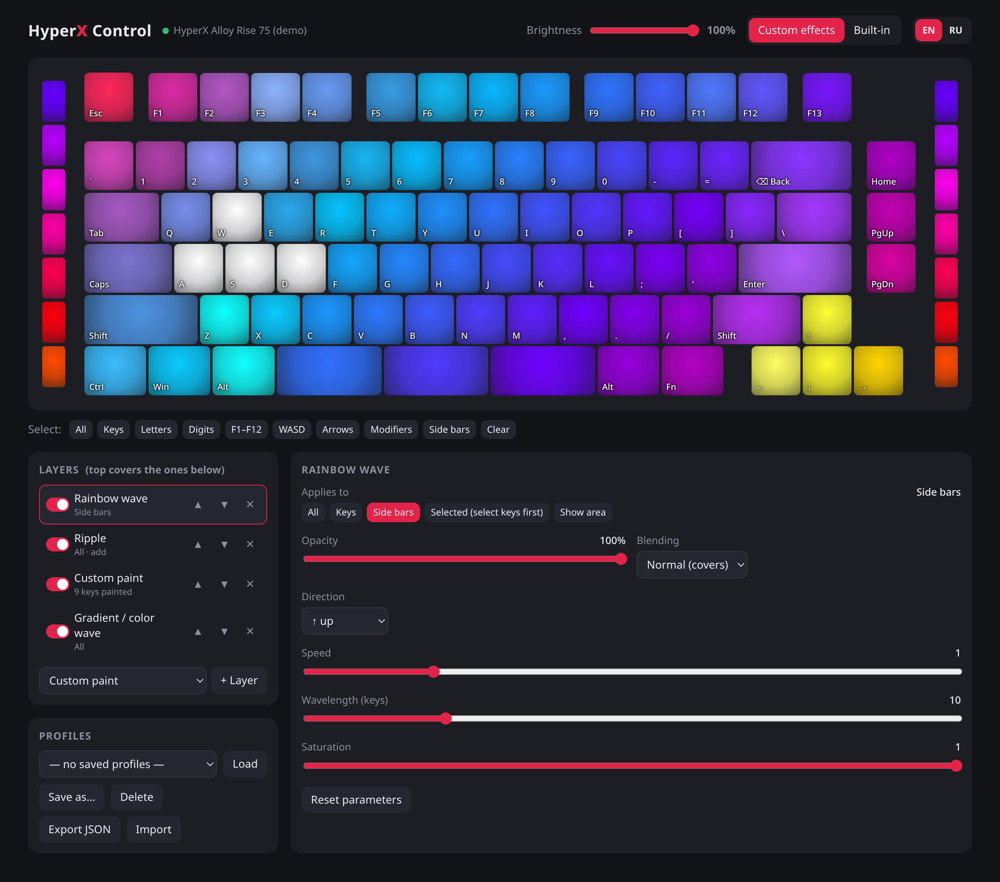

# hyper_ctl

**English** | [Русский](README.ru.md)

RGB lighting control for the **HyperX Alloy Rise 75 Wireless** on Linux — an NGENUITY replacement for lighting.
Works with any keyboard that implements the **HID LampArray** standard.

Pure Python 3.8+, no dependencies: talks to the keyboard directly through `/dev/hidraw*` (ioctl).

  



## Features

- **Web UI** with a live preview of what is lit on the keyboard right now (English / Russian)
- **Effect layers** like in NGENUITY: toggle, reorder, opacity, blending mode (normal / add / multiply),
  target area (everything, keys only, side bars, selected keys)
- **12 effects**:
  - ambient: custom per-key paint, solid color, breathing, color cycle, rainbow wave, gradient,
    starlight, rain, fire
  - reactive ⚡ (driven by key presses): reactive keys, ripple, typing heatmap
- All 96 lamps: 82 keys, Fn, F13, 3 spacebar segments, 7 side bar segments on each side
- Global brightness, one-click switch back to the keyboard's built-in effects
- Named profiles, JSON export / import
- Works over cable and through the wireless dongle, reconnects automatically
- CLI for scripting and a systemd background service

## Installation

```sh
git clone git@github.com:dvaxert/hyper_ctl.git
cd hyper_ctl
./install.sh      # asks for the sudo password
```

The script:
1. looks for connected keyboards with HID LampArray — if none is found, it stops with an error
   without changing anything (plug the keyboard in and run it again);
2. generates a udev rule `/etc/udev/rules.d/70-hyper_ctl.rules` for the devices found
   (access without root, works over USB and Bluetooth). IDs from an already installed rule are kept,
   so the cable and the dongle can be added in two runs;
3. copies the program to `/opt/hyper_ctl`, installs a systemd user unit into `/etc/systemd/user/`,
   enables the service and checks that it started.

After that the cloned repository can be deleted.

- update: `git pull && ./install.sh`
- uninstall: `./uninstall.sh`
- custom install path: `PREFIX=/usr/local/lib/hyper_ctl ./install.sh`
- see what will be detected and which rule will be generated, without changing anything: `./install.sh --print-rule`

> The `70-` prefix of the udev rule matters: the `uaccess` tag is processed in `73-seat-late.rules`,
> so the rule must come earlier.

**Settings** live in `~/.config/hyper_ctl/`: the current profile is `profile.json`, named profiles are
`profiles/*.json`. Installing and uninstalling never touches them.

## Usage

### Web UI

Once installed, the UI is always available at **http://127.0.0.1:8075/** (served by the background service).
Every change is applied and saved immediately.

- click / Shift+click / drag — select keys
- “Custom paint” layer: select keys → “Paint selected” (or double-click a key)
- for other layers, “Selected” limits the effect to the selected keys
- right-click a color in a color list to remove it
- EN / RU switch in the top right corner

Running it manually (without the service):

```sh
python3 hyper_ui.py            # opens http://127.0.0.1:8075/
python3 hyper_ui.py --demo     # no keyboard needed, Alloy Rise 75 layout
```

### Service

Effects are computed on the host, so a background service keeps them running. It starts when you log in
and picks the keyboard up again after sleep or reconnect. When it stops, the keyboard returns to its
built-in effects.

```sh
systemctl --user restart hyper-ctl     # restart
systemctl --user stop hyper-ctl        # stop
journalctl --user -u hyper-ctl -f      # logs
```

### CLI

```sh
python3 /opt/hyper_ctl/hyper_ctl.py info                     # lamps, key names, positions
python3 /opt/hyper_ctl/hyper_ctl.py color ff0000             # fill everything
python3 /opt/hyper_ctl/hyper_ctl.py key 00ff00 wasd esc f1   # individual keys / groups
python3 /opt/hyper_ctl/hyper_ctl.py off                      # turn off
python3 /opt/hyper_ctl/hyper_ctl.py auto                     # back to built-in effects
python3 /opt/hyper_ctl/hyper_ctl.py run [profile.json]       # play a profile without the UI
```

Groups: `all`, `keys`, `letters`, `digits`, `fkeys`, `arrows`, `wasd`, `mods`, `space`, `lbar`, `rbar`, `bars`.
A single lamp can be addressed as `lampN` (number from `info`).

## Compatibility

hyper_ctl does not use any HyperX-specific protocol — it only needs **HID LampArray** in the keyboard
firmware (the open standard behind Windows Dynamic Lighting). Older HyperX models without it
(Alloy FPS, Elite, early Origins) are not supported. Devices that implement LampArray only through
a Windows driver will not show it on Linux either.

To check a keyboard, run:

```sh
for d in /sys/class/hidraw/*; do xxd -p -l4 $d/device/report_descriptor | grep -q ^05590901 && echo "$(basename $d): $(grep HID_NAME $d/device/uevent)"; done
```

If it prints the keyboard, hyper_ctl will drive it (`./install.sh --print-rule` performs the same check).
The UI drawing is tuned for an ANSI layout — on ISO or full-size boards lighting works, but the
on-screen picture may look slightly off.

## Project layout

| File | Contents |
|---|---|
| `hyper_ctl.py` | device access (HID LampArray over hidraw), lamp naming, CLI |
| `effects.py` | engine: layers, blending, effects, key press reading for reactive effects |
| `hyper_ui.py` | stdlib HTTP server + single-page UI |
| `hyper-ctl.service` | systemd user unit template (`install.sh` fills in the path) |
| `install.sh` / `uninstall.sh` | keyboard detection, udev rule generation, install to `/opt/hyper_ctl` + service / removal |

A new effect is a class in `effects.py` with the `@effect` decorator, a parameter description in `SCHEMA`
(the UI builds the form from it) and a `render(t, dt, ids)` method returning `{lamp_id: (r, g, b, alpha)}`.
For key press reactions set `REACTIVE = True` and implement `on_key(lamp_id, t)`.
Add a Russian translation for the new strings to the `RU` dictionary in `hyper_ui.py`.

## How it works and limitations

The keyboard exposes several HID interfaces. Lighting is available through the standard **HID LampArray**
(usage page `0x59`) — an open protocol Windows uses for Dynamic Lighting.
The update rate is limited by the keyboard itself (~30 fps).

The keyboard shows up as two USB devices: cable (`03f0:0eb8`) and dongle (`03f0:01b9`).
Commands are sent to both; while the cable is connected the dongle ignores them and reports an inflated
LampCount with garbage past lamp 96 — this is handled.

Key presses for reactive effects are read from the keyboard's hidraw nodes alongside the system
(input is not grabbed, nothing typed is stored).

**Not supported** (requires the closed NGENUITY vendor protocol on interface `0xFF90`):
key remapping, macros, storing effects and profiles in the keyboard's onboard memory, ambient light
sensor settings. Remapping and macros can be done on the Linux side, e.g. with
[keyd](https://github.com/rvaiya/keyd).
