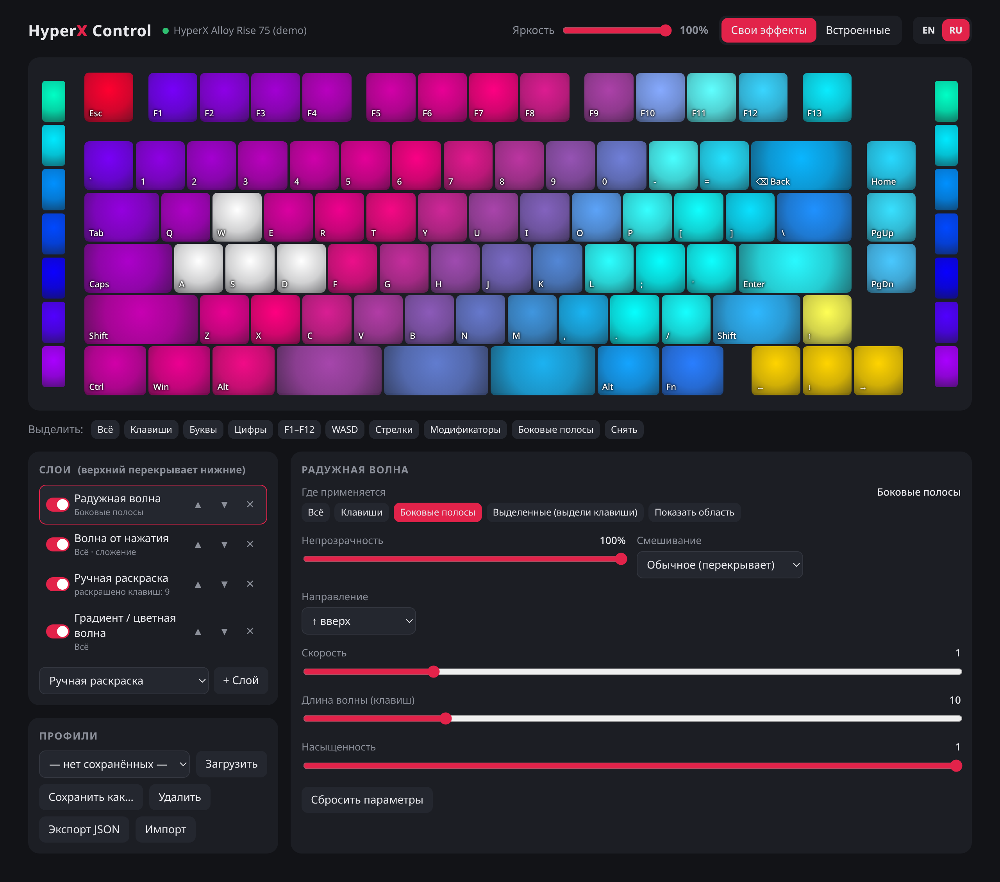

# hyper_ctl

[English](README.md) | **Русский**

Управление RGB-подсветкой **HyperX Alloy Rise 75 Wireless** под Linux — замена NGENUITY для подсветки.
Работает с любой клавиатурой, поддерживающей стандарт **HID LampArray**.

Чистый Python 3.8+, без зависимостей: общение с клавиатурой идёт напрямую через `/dev/hidraw*` (ioctl).

   [](LICENSE)



## Возможности

- **Веб-интерфейс** с живым превью того, что сейчас горит на клавиатуре (английский / русский)
- **Слои эффектов** как в NGENUITY: включение/выключение, порядок, непрозрачность, режим смешивания
  (обычное / сложение / умножение), область применения (всё, клавиши, боковые полосы, выделенные клавиши)
- **12 эффектов**:
  - статичные/фоновые: ручная раскраска по клавишам, сплошной цвет, дыхание, смена цветов,
    радужная волна, градиент, звёздное небо, дождь, огонь
  - реактивные ⚡ (по нажатиям): подсветка нажатий, волна от нажатия, тепловая карта набора
- Все 96 ламп: 82 клавиши, Fn, F13, 3 сегмента пробела, по 7 сегментов боковых полос слева и справа
- Общая яркость, переключение на встроенные эффекты клавиатуры
- Именованные профили, экспорт/импорт JSON
- Работает по проводу и через донгл, переподключается автоматически
- CLI для скриптов и фоновый режим через systemd

## Установка

```sh
git clone git@github.com:dvaxert/hyper_ctl.git
cd hyper_ctl
./install.sh      # спросит пароль sudo
```

Скрипт:
1. ищет подключённые клавиатуры с HID LampArray — если не нашёл ни одной, останавливается с ошибкой,
   ничего не меняя (подключи клавиатуру и запусти снова);
2. генерирует под найденные устройства udev-правило `/etc/udev/rules.d/70-hyper_ctl.rules`
   (доступ без root; работает и по USB, и по Bluetooth). ID из уже установленного правила сохраняются,
   так что провод и донгл можно добавить в два захода;
3. копирует программу в `/opt/hyper_ctl`, ставит systemd user unit в `/etc/systemd/user/`,
   включает сервис и проверяет, что он запустился.

После этого репозиторий можно удалить.

- обновление: `git pull && ./install.sh`
- удаление: `./uninstall.sh`
- другой путь установки: `PREFIX=/usr/local/lib/hyper_ctl ./install.sh`
- посмотреть, что найдётся и какое будет правило, ничего не меняя: `./install.sh --print-rule`

> udev-правило называется `70-…` неслучайно: тег `uaccess` обрабатывается в `73-seat-late.rules`,
> правило должно идти раньше.

**Настройки** хранятся в `~/.config/hyper_ctl/`: текущий профиль — `profile.json`, именованные профили —
`profiles/*.json`. Установка и удаление их не трогают.

## Использование

### Веб-интерфейс

После установки UI всегда доступен на **http://127.0.0.1:8075/** (его обслуживает фоновый сервис).
Изменения применяются и сохраняются сразу.

- клик / Shift+клик / протяжка мышью — выделить клавиши
- слой «Ручная раскраска»: выделить клавиши → «Покрасить выделенные» (или двойной клик по клавише)
- для остальных слоёв «Выделенные» ограничивает эффект выделенными клавишами
- ПКМ по цвету в списке цветов — удалить цвет
- переключатель EN / RU в правом верхнем углу

Ручной запуск (без сервиса):

```sh
python3 hyper_ui.py            # откроет http://127.0.0.1:8075/
python3 hyper_ui.py --demo     # без клавиатуры, с раскладкой Alloy Rise 75
```

### Сервис

Эффекты рассчитываются на компьютере, поэтому их крутит фоновый сервис. Он стартует при входе в систему
и сам находит клавиатуру после сна или переподключения. При остановке подсветка возвращается
к встроенным эффектам клавиатуры.

```sh
systemctl --user restart hyper-ctl     # перезапустить
systemctl --user stop hyper-ctl        # остановить
journalctl --user -u hyper-ctl -f      # логи
```

### CLI

```sh
python3 /opt/hyper_ctl/hyper_ctl.py info                     # список ламп, имена клавиш, координаты
python3 /opt/hyper_ctl/hyper_ctl.py color ff0000             # залить всё
python3 /opt/hyper_ctl/hyper_ctl.py key 00ff00 wasd esc f1   # отдельные клавиши / группы
python3 /opt/hyper_ctl/hyper_ctl.py off                      # погасить
python3 /opt/hyper_ctl/hyper_ctl.py auto                     # вернуть встроенные эффекты клавиатуры
python3 /opt/hyper_ctl/hyper_ctl.py run [profile.json]       # проигрывать профиль без UI
```

Группы: `all`, `keys`, `letters`, `digits`, `fkeys`, `arrows`, `wasd`, `mods`, `space`, `lbar`, `rbar`, `bars`.
Отдельную лампу можно указать как `lampN` (номер из `info`).

## Совместимость

hyper_ctl не использует протокол HyperX — ему нужен только **HID LampArray** в прошивке клавиатуры
(открытый стандарт, на котором построен Dynamic Lighting в Windows). Старые модели HyperX без него
(Alloy FPS, Elite, ранние Origins) не поддерживаются. Устройства, где LampArray реализован только
драйвером под Windows, на Linux его тоже не покажут.

Проверить клавиатуру:

```sh
for d in /sys/class/hidraw/*; do xxd -p -l4 $d/device/report_descriptor | grep -q ^05590901 && echo "$(basename $d): $(grep HID_NAME $d/device/uevent)"; done
```

Если команда вывела клавиатуру — hyper_ctl с ней заработает (`./install.sh --print-rule` делает ту же проверку).
Отрисовка в UI рассчитана на ANSI-раскладку: на ISO и полноразмерных клавиатурах подсветка работает,
но картинка на экране может выглядеть чуть криво.

## Устройство проекта

| Файл | Что внутри |
|---|---|
| `hyper_ctl.py` | работа с устройством (HID LampArray через hidraw), имена ламп, CLI |
| `effects.py` | движок: слои, смешивание, эффекты, чтение нажатий для реактивных эффектов |
| `hyper_ui.py` | HTTP-сервер на stdlib + одностраничный UI |
| `hyper-ctl.service` | шаблон systemd user unit (путь подставляет `install.sh`) |
| `install.sh` / `uninstall.sh` | поиск клавиатуры, генерация udev-правила, установка в `/opt/hyper_ctl` + сервис / удаление |

Новый эффект — это класс в `effects.py` с декоратором `@effect`, описанием параметров в `SCHEMA`
(UI сам построит форму) и методом `render(t, dt, ids)`, возвращающим `{lamp_id: (r, g, b, alpha)}`.
Для реакции на нажатия — `REACTIVE = True` и метод `on_key(lamp_id, t)`.
Перевод новых строк на русский добавь в словарь `RU` в `hyper_ui.py`.

## Как это работает и ограничения

У клавиатуры несколько HID-интерфейсов. Подсветка доступна через стандартный **HID LampArray**
(usage page `0x59`) — открытый протокол, который Windows использует для Dynamic Lighting.
Частота обновления ограничена самой клавиатурой (~30 кадров/с).

Подключение видно как два USB-устройства: провод (`03f0:0eb8`) и донгл (`03f0:01b9`).
Команды отправляются на оба; при подключённом кабеле донгл их игнорирует и сообщает завышенный
LampCount с мусором после 96-й лампы — это учитывается.

Нажатия для реактивных эффектов читаются с hidraw клавиатуры параллельно системе (ввод не перехватывается,
набранное никуда не сохраняется).

**Не поддерживается** (требует закрытого вендорского протокола NGENUITY, интерфейс `0xFF90`):
ремап клавиш, макросы, запись эффектов и профилей во внутреннюю память клавиатуры, настройка
датчика освещённости. Ремап и макросы можно сделать на стороне Linux, например через
[keyd](https://github.com/rvaiya/keyd).

## Лицензия

[MIT](LICENSE)
